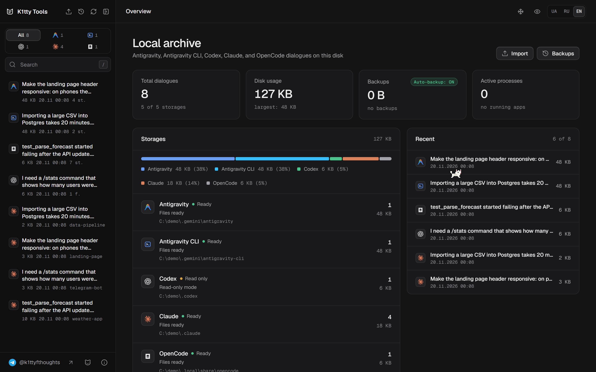
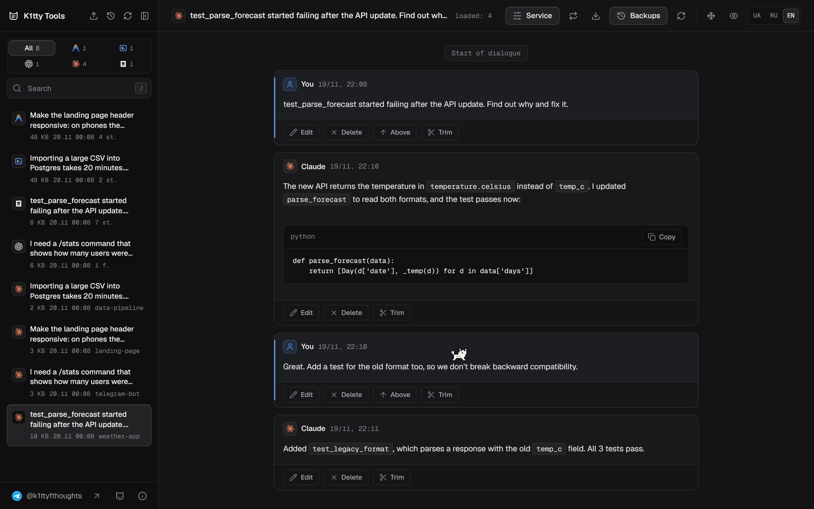
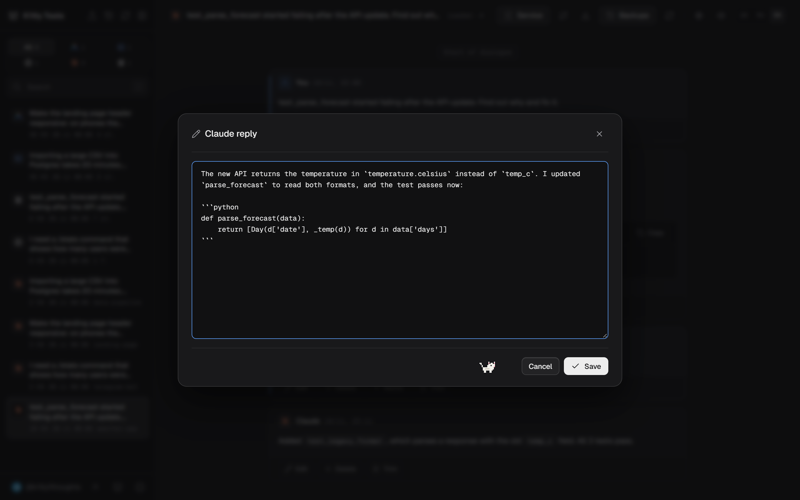
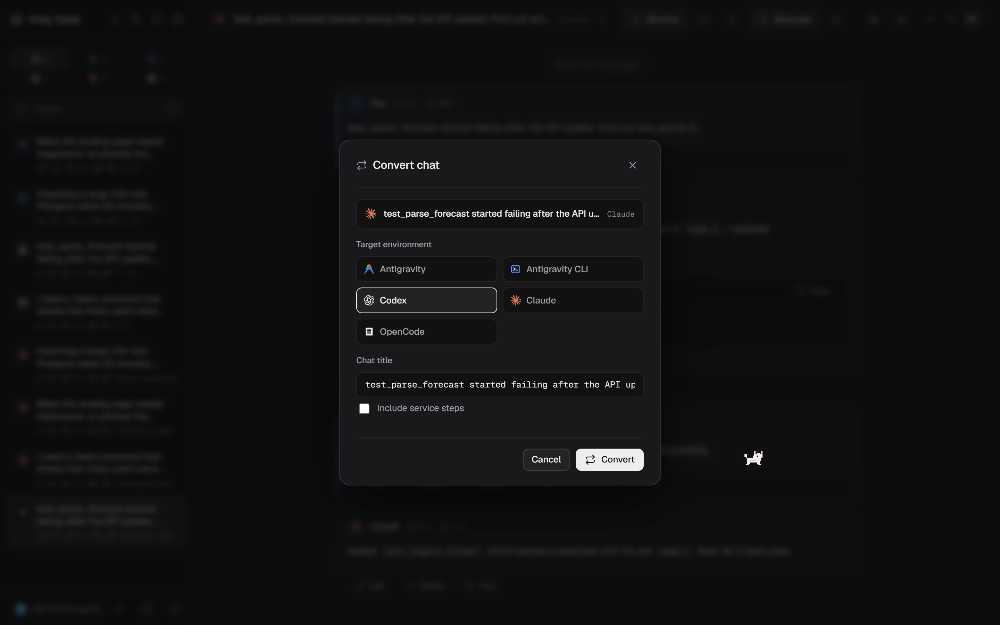
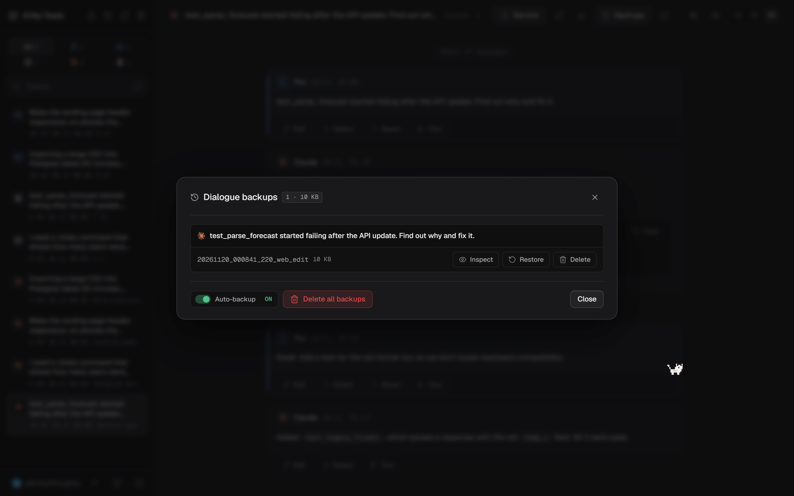

# K1tty Tools

Python-скрипт с веб-интерфейсом для просмотра, редактирования, очистки и переноса истории диалогов в Google Antigravity, OpenAI Codex, Claude Code и OpenCode.

A Python script with a web interface for viewing, editing, cleaning, and transferring conversation history between Google Antigravity, OpenAI Codex, Claude Code, and OpenCode.



## Возможности / Features

### Блокировки в Codex / Codex Locks

Когда Codex блокирует чат из-за фильтров безопасности, инструмент показывает причину и снимает блокировку в один клик. Тред можно и вручную заблокировать с любой указанной причиной для тестов.

When Codex blocks a chat due to safety filters, the tool shows the reason and unlocks it in one click. You can also manually lock a thread with any custom reason for testing purposes.

### Редактирование сообщений и системных промптов / Editing Messages and System Prompts

Можно менять системный промпт, внутренние инструкции и метаданные чата. Править текст сообщений пользователя и ответы модели. Править вызовы инструментов и ошибки, не ломая структуру файла.

You can edit the system prompt, internal instructions, and chat metadata. Modify user messages and model responses. Edit tool calls and errors without breaking the file structure.

<p>
  
  
</p>

### Удаление и обрезка истории / Deleting and Trimming History

Удаление отдельных сообщений без сбоя нумерации шагов. Обрезка начала диалога до выбранного места или удаление всей переписки после нужного шага. Полное удаление ненужных диалогов из папок приложений.

Delete individual messages without breaking step numbering. Trim the beginning of a conversation up to a selected point, or remove everything after a specific step. Completely delete unwanted conversations from the application folders.

### Конвертация между средами / Conversion Between Environments

Перенос диалогов между любыми из четырёх сред:

- Antigravity в Codex, Claude, OpenCode
- Codex в Antigravity, Claude, OpenCode
- Claude в Antigravity, Codex, OpenCode
- OpenCode в Antigravity, Codex, Claude

Скрипт переводит формат сообщений, роли и вызовы инструментов под требования целевого приложения.

Transfer conversations between any of the four environments:

- Antigravity → Codex, Claude, OpenCode
- Codex → Antigravity, Claude, OpenCode
- Claude → Antigravity, Codex, OpenCode
- OpenCode → Antigravity, Codex, Claude

The script converts message formats, roles, and tool calls to match the requirements of the target application.



### Бэкапы / Backups

Автобэкапы отключаются тумблером. Показывает вес диалогов и бэкапов по каждому приложению. Любую сохранённую копию можно открыть и восстановить.

Automatic backups can be toggled off. Shows the size of conversations and backups for each application. Any saved copy can be opened and restored.



## Примеры использования / Usage Examples

**Подмена ответов модели / Spoofing Model Responses.** Можно отредактировать прошлый ответ ассистента в истории так, чтобы модель в следующем шаге опиралась на него как на собственный вывод. Это показывает, насколько модель доверяет своему прошлому ответу и как далеко может уйти от исходной линии рассуждения, если предыдущий шаг подменён. Полезно для оценки устойчивости к prompt injection через историю.

You can edit a previous assistant response in the history so that the model treats it as its own previous output in the next step. This demonstrates how much the model trusts its past responses and how far it can deviate from the original reasoning path when a previous step is spoofed. Useful for evaluating robustness against prompt injection via conversation history.

**Восстановление чата после срабатывания Safety Guard / Recovering a Chat After Safety Guard Trigger.** Когда чат получил Safe Guard и модель отказывается продолжать работу, причину можно найти по истории. Дальше два пути. Первый — отредактировать сообщение, которое триггернуло фильтр, или подменить ответ модели на нейтральный, чтобы следующий шаг опирался на него как на собственный вывод. Второй — откатиться до сообщения перед срабатыванием, удалив всё после него, и продолжить с чистой точки. Оба варианта возвращают чат в рабочее состояние, а исходную ветку можно сохранить в бэкапе и восстановить позже.

When a chat hits a Safety Guard and the model refuses to continue, you can find the cause in the history. There are two approaches. First — edit the message that triggered the filter, or replace the model’s response with a neutral one so the next step treats it as its own previous output. Second — roll back to the message before the trigger by deleting everything after it, and continue from a clean point. Both methods restore the chat to a working state, while the original branch can be saved in a backup and restored later.

**Подмена системного промпта / Spoofing the System Prompt.** Смена системного промпта в существующем чате позволяет сравнить поведение модели на одном и том же наборе сообщений при разных инструкциях. Этот сценарий особенно удобен для внедрения джейлбрейка. Системный промпт задаёт рамку, в которой модель интерпретирует всю переписку, поэтому его правка меняет поведение сразу во всех следующих шагах, без необходимости редактировать отдельные сообщения. Можно подставить роль, стиль ответа или набор разрешений, которые через интерфейс не выставить, и посмотреть, как модель реагирует на тот же диалог в новой рамке. Полезно и для сравнения, как формулировка системного промпта влияет на отказы, стиль и выбор инструментов.

Changing the system prompt in an existing chat lets you compare the model’s behavior on the same set of messages under different instructions. This scenario is especially useful for injecting a jailbreak. The system prompt defines the frame in which the model interprets the entire conversation, so editing it immediately changes behavior in all subsequent steps without needing to modify individual messages. You can inject a role, response style, or set of permissions that cannot be set through the UI, and observe how the model reacts to the same dialogue under the new frame. Also useful for comparing how system prompt wording affects refusals, style, and tool selection.

**Подмена контекста (context spoofing) / Context Spoofing.** Редактирование метаданных, ролей и tool calls даёт возможность собрать состояние чата, которое через интерфейс не создать. Это позволяет тестировать, как модель реагирует на нестандартные или противоречивые состояния контекста.

Editing metadata, roles, and tool calls lets you construct chat states that cannot be created through the UI. This enables testing how the model reacts to non-standard or contradictory context states.

**Контролируемое тестирование джейлбрейков / Controlled Jailbreak Testing.** В локальной среде можно воспроизводимо проверять, какие формулировки промптов и какая структура истории приводят к обходу ограничений, а какие нет. Результат воспроизводим, потому что состояние чата хранится в файле и его можно откатить.

In a local environment you can reproducibly test which prompt formulations and conversation structures lead to bypassing restrictions and which do not. Results are reproducible because the chat state is stored in a file and can be rolled back.

**Перенос сценариев между средами / Transferring Scenarios Between Environments.** Один и тот же диалог можно перенести в другую среду и посмотреть, как её модель ведёт себя на идентичном контексте. Это даёт сравнение моделей на одинаковых входных данных.

The same conversation can be transferred to another environment to see how its model behaves on an identical context. This enables direct model comparison on the same inputs.

## Требования / Requirements

- **Python 3.14+** — используется встроенный модуль `compression.zstd` / uses the built-in `compression.zstd` module
- Зависимости / Dependencies: `aiohttp`, `psutil` ([`requirements.txt`](requirements.txt))
- Windows, macOS или Linux / Windows, macOS or Linux

> **Ограничения на macOS и Linux / macOS and Linux limitations:**
> - История Codex открывается только для просмотра — редактирование Codex работает только на Windows.
> - Claude Code нельзя править, пока он запущен: на этих системах нельзя проверить, занят ли конкретный файл сессии, поэтому правка блокируется целиком, пока работает любой процесс Claude.
>
> - Codex history is read-only — editing Codex is Windows-only.
> - Claude Code history can’t be edited while Claude is running: these systems can’t tell whether a specific session file is in use, so editing is blocked while any Claude process is running.

## Установка и запуск / Installation and Running

После запуска сервер сам откроет браузер на `http://127.0.0.1:8780`.  
Once started, the server opens your browser at `http://127.0.0.1:8780`.

### Windows

1. Установить Python 3.14+ с [python.org](https://www.python.org/downloads/) (отметить «Add python.exe to PATH») или через winget:  
   Install Python 3.14+ from [python.org](https://www.python.org/downloads/) (check “Add python.exe to PATH”) or via winget:
   ```powershell
   winget install Python.Python.3.14
   ```
2. Склонировать репозиторий и запустить / Clone and run:
   ```powershell
   git clone https://github.com/quesada-lab/k1tty-tools.git
   cd k1tty-tools
   py -3.14 -m venv .venv
   .venv\Scripts\activate
   pip install -r requirements.txt
   python -X utf8 server.py
   ```

### macOS

1. Установить Python 3.14+ / Install Python 3.14+:
   ```bash
   brew install python@3.14
   ```
2. Склонировать репозиторий и запустить / Clone and run:
   ```bash
   git clone https://github.com/quesada-lab/k1tty-tools.git
   cd k1tty-tools
   python3.14 -m venv .venv
   source .venv/bin/activate
   pip install -r requirements.txt
   python -X utf8 server.py
   ```

### Linux

1. Установить Python 3.14+ из пакетов дистрибутива, а если его там ещё нет — через [uv](https://docs.astral.sh/uv/) или [pyenv](https://github.com/pyenv/pyenv).  
   Install Python 3.14+ from your distro packages, or via [uv](https://docs.astral.sh/uv/) / [pyenv](https://github.com/pyenv/pyenv) if your distro doesn’t ship it yet.
2. Склонировать репозиторий и запустить / Clone and run:
   ```bash
   git clone https://github.com/quesada-lab/k1tty-tools.git
   cd k1tty-tools
   python3.14 -m venv .venv
   source .venv/bin/activate
   pip install -r requirements.txt
   python -X utf8 server.py
   ```

### Через uv (любая ОС) / With uv (any OS)

[uv](https://docs.astral.sh/uv/) сам скачает нужный Python и зависимости:  
[uv](https://docs.astral.sh/uv/) downloads the right Python and dependencies by itself:

```bash
uv run --python 3.14 --with-requirements requirements.txt python -X utf8 server.py
```

### Параметры запуска / Launch Options

| Параметр / Option | Описание / Description |
|---|---|
| `python -X utf8 server.py 9000` | другой порт (по умолчанию 8780) / custom port (default 8780) |
| `--no-open` или / or `NO_BROWSER=1` | не открывать браузер / don’t open the browser |

### Нестандартные пути к данным / Custom Data Paths

По умолчанию данные ищутся в домашней папке пользователя. Пути можно переопределить переменными окружения:  
By default data is looked up in the user’s home directory. Override the paths with environment variables:

| Переменная / Variable | По умолчанию / Default |
|---|---|
| `ANTIGRAVITY_APPDATA` | `~/.gemini/antigravity` |
| `ANTIGRAVITY_CLI_APPDATA` | `~/.gemini/antigravity-cli` |
| `CLAUDE_HOME` | `~/.claude` |
| `CODEX_HOME` | `~/.codex` |
| `OPENCODE_DATA_DIR` | `~/.local/share/opencode` |

### Где хранятся бэкапы / Where Backups Are Stored

| Среда / App | Папка / Folder | Переменная / Variable |
|---|---|---|
| Antigravity | `backups/antigravity/` | `ANTIGRAVITY_BACKUP_ROOT` |
| Antigravity CLI | `backups/antigravity_cli/` | `ANTIGRAVITY_CLI_BACKUP_ROOT` |
| OpenCode | `backups/opencode/` | `OPENCODE_BACKUP_ROOT` |
| Claude Code | `~/claude_backups/` (рядом с / next to `CLAUDE_HOME`) | — |
| Codex | `~/codex_backups/` (рядом с / next to `CODEX_HOME`) | — |

Пути `backups/...` указаны относительно папки проекта. Список бэкапов, их размер и восстановление доступны в интерфейсе.  
`backups/...` paths are relative to the project folder. The UI lists backups, shows their size and restores them.

## Структура проекта / Project Structure

```
k1tty-tools/
├── server.py             # веб-сервер (aiohttp), точка входа / web server, entry point
├── requirements.txt      # зависимости Python / Python dependencies
├── engines/              # чтение и запись истории каждой среды, конвертер, монитор процессов
│                         # per-app history I/O, converter, process monitor
├── providers/            # адаптеры сред для сервера / app adapters used by the server
├── docs/screenshots/     # скриншоты для README / README screenshots
└── static/               # веб-интерфейс (HTML/JS/CSS) / web UI
    └── icons/
```

Бэкапы (`backups/`) и настройки (`k1tty_settings.json`) создаются локально и в репозиторий не попадают.  
Backups (`backups/`) and settings (`k1tty_settings.json`) are created locally and are excluded from the repository.

## Обновление со старой версии / Upgrading From an Older Version

Раньше код лежал в папке `k1tty_editor/`. После `git pull` и первого запуска `server.py` бэкапы и настройки из `k1tty_editor/` автоматически переносятся в корень проекта; существующие файлы не перезаписываются. Запускать теперь нужно `server.py` вместо `K1ttyTools.bat`.

The code used to live in `k1tty_editor/`. After `git pull`, the first run of `server.py` moves backups and settings from `k1tty_editor/` to the project root without overwriting existing files. Run `server.py` instead of `K1ttyTools.bat` from now on.

## Лицензия / License

[MIT](LICENSE)
